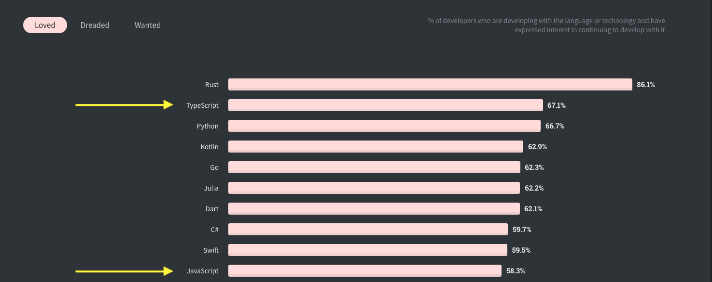
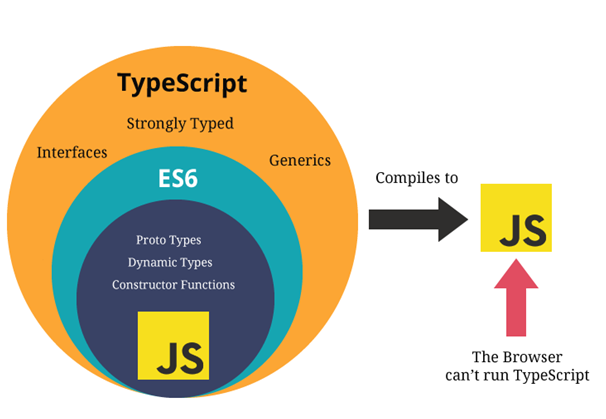
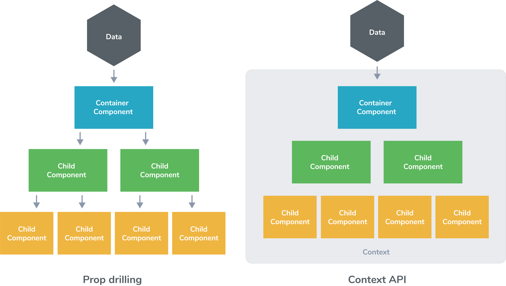
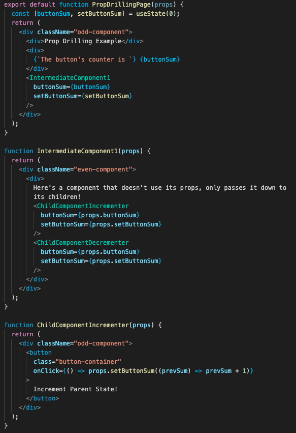
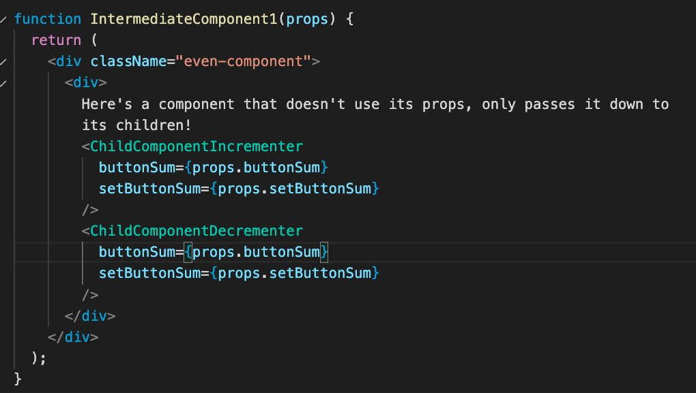
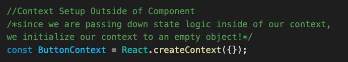
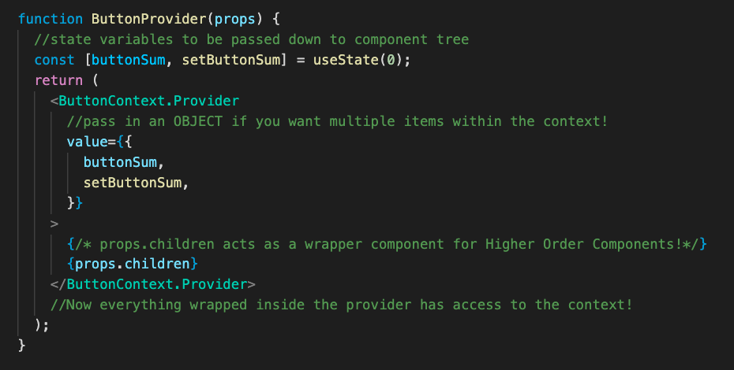
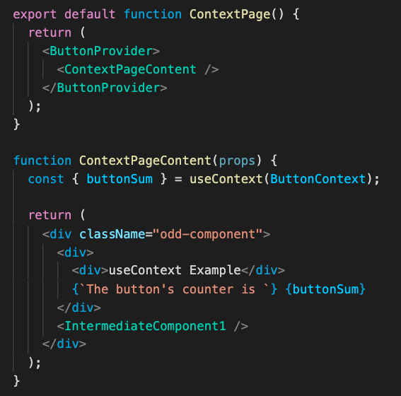
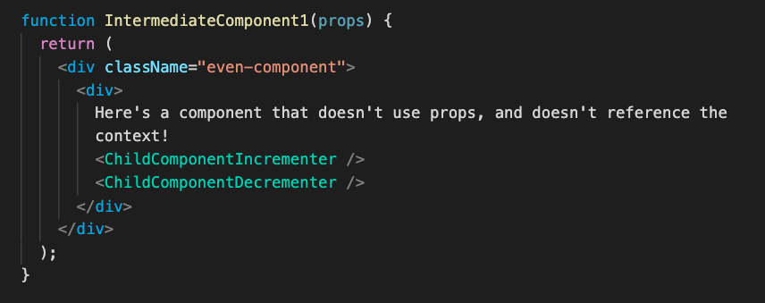
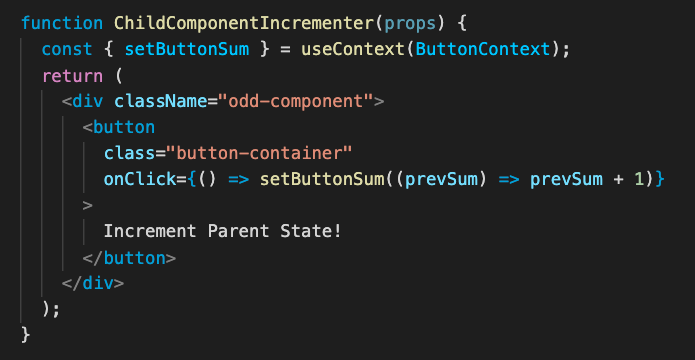

# TypeScript and React Hooks

Today we'll cover how TypeScript solves some of the problems with JavaScript, and some more React Hooks and tools that help us manage state across our apps.

## Table of Contents

- [JavaScript To TypeScript](#javascript-to-typescript)
  - [Common Issues With JavaScript](#common-issues-with-javascript)
    - [Wrong Function Arguments](#wrong-function-arguments)
    - [Refactoring Struggles](#refactoring-struggles)
  - [What is TypeScript](#what-is-typescript)
  - [How Does TypeScript Work](#how-does-typescript-work)
  - [Getting Started With TypeScript](#getting-started-with-typescript)
  - [Typing](#typing)
  - [Interfaces](#interfaces)
- [TypeScript In React](#typescript-in-react)
  - [Union Types](#union-types)
  - [Enums](#enums)
  - [Typed Props](#typed-props)
  - [Typed State](#typed-state)
- [React Hooks](#react-hooks)
- [useEffect and the React Lifecycle](#useEffect-and-the-react-lifecycle)
  - [Using the UseEffect Hook](#using-the-useeffect-hook)
- [useContext and Global State Management](#useContext-and-global-state-management)
- [Prop Drilling](#prop-drilling)
  - [Pros of Prop Drilling](#pros-of-prop-drilling)
  - [Cons of Prop Drilling](#cons-of-prop-drilling)
  - [How Do State Management Tools Solve the Problems?](#how-do-state-management-tools-solve-the-problems)
  - [Centralized State Logic](#centralized-state-logic)
- [useContext](#usecontext)
  - [Context Set-Up Outside of Component Trees](#context-set-up-outside-of-component-trees)
  - [Higher Order Components](#higher-order-components)
  - [Pros of React Context](#pros-of-react-context)
  - [Cons of React Context](#cons-of-react-context)
- [Jotai](#jotai)
  - [Creating Atoms](#creating-atoms)
  - [Using Atoms](#using-atoms)
- [Conclusion](#conclusion)

## JavaScript To TypeScript

Developers have a love-hate relationship with JavaScript. Even though JavaScript is the [most commonly used language in the world](https://bootcamp.berkeley.edu/blog/most-in-demand-programming-languages/), it is only ranked #10 on the most loved languages according to StackOverflow's yearly developer survey while TypeScript is all the way up to #2!



**Why is that the case?**

## Common Issues With JavaScript

Since JavaScript is a dynamically typed language (which means that variables can change types), JavaScript fails to catch a lot of errors and makes refactoring code in the future hard.

### Wrong Function Arguments

Let's take a look at this function that divides two numbers!

```js
function divideTwoNums(a, b) {
  return a / b;
}
```

If we try running our code with two arguments that are both numbers, then the function works perfectly fine.

```js
console.log(divideTwoNums(8, 4));
//returns 2
```

However, if we try to pass in two arguments that are **_not_** numbers into `divideTwoNums`, we can see that some issues arise!

```js
console.log(divideTwoNums("apple", "banana"));
//returns NaN
```

**Should we be able to pass in "apple" and "banana" into our function `divideTwoNums`?
**

[TypeScript's Solution Here!](#typing)

### Refactoring Struggles

Let's take a look at a function that calls a pet argument we pass in!

```js
function callPet(pet) {
  return "Come here " + pet + "!";
}
```

We can call it like so:

```js
const myPet = "Rufus";
console.log(callPet(myPet));
//Prints out "Come here Rufus!"
```

However, let's say that we want to change the structure of our pet parameter for the function `callPet` to be a pet object like so:

```js
const newPet = {
  name: {
    first: "Rufus",
    last: "the Third",
  },
  type: "dog",
};
```

Even though our code editor won't spit any errors at us when we try running `callPet(newPet)`, the application **will** crash, but the error will point us towards the function instead of where the problem **really lies**, inside the function call.

```js
/*Our terminal tells us: TypeError: Cannot read property 'first' of undefined at callPet, even though our code editor thinks this is perfectly fine!  */
console.log(callPet(newPet));
```

This can be a **serious problem** since application crashes can be very costly for companies and we want to be able to detect our errors at the source!

[TypeScript's Solution Here!](#interfaces)

### What is TypeScript?

[TypeScript](https://www.typescriptlang.org) is an open-source language built on top of JavaScript that addresses the issues of JavaScript being a dynamically typed language by adding **static type definitions.** (types that are determined at compile time)



TypeScript is a **superset** of JavaScript which means that all JavaScript is valid TypeScript, but not all TypeScript is valid JavaScript.

### How Does TypeScript Work?


### [Compiled Vs Interpreted Languages](https://www.geeksforgeeks.org/difference-between-compiled-and-interpreted-language/)

While JavaScript is an **interpreted language**, which means that it gets read by an interpreter like a web-browser instead of compiled into machine code, TypeScript is a **compiled language** which means that TypeScript gets converted to JavaScript when you compile it, which offers a vast number of benefits!

- You can debug applications before they're being run, at compile-time.
- Your IDE can auto-fill properties of objects (with ctrl/cmd space).
- Compilation errors help reduce the chance of you making errors and help catch errors.

### Getting Started With TypeScript

Since TypeScript is built on top of JavaScript, we're going to need to add it to our project's dependencies with:

```sh
$ pnpm add -D typescript
```

This gives us access to the TypeScript compiler, `tsc`, which we run through `pnpm exec`.

To initialize TypeScript in our project, we have to run:

```sh
$ pnpm exec tsc --init
```

This creates a `tsconfig.json` file in the root of our current directory and allows us to customize what we want TypeScript to allow or do.

We can compile a single file with:

```sh
$ pnpm exec tsc path/to/file.ts
```

This checks for errors and creates a JavaScript version of the file next to it.

The great thing about it is that it checks for type errors **before** we have to run the code and provides more thorough error messages which is amazing!

For a React project, you don't need to set any of this up by hand. Vite creates a project with TypeScript already configured:

```sh
$ pnpm create vite my-blog-ts --template react-ts
```

Now, let's go over some of the usages of TypeScript with some examples in small node scripts!

An in-depth guide to learning TypeScript from JavaScript is also offered on the official [TypeScript website](https://www.typescriptlang.org/docs/handbook/typescript-in-5-minutes.html)!

### Typing

Do you remember our [divideTwoNums function from earlier](#wrong-function-arguments)?

Even though it expected two numbers, we were allowed to pass in parameters that were **not** numbers which gave us unintended results!

However with TypeScript's typing denoted by the `:` symbol, we **have** to declare what are the types of return values of functions and the types of the function's arguments!

Let's take a look at the `divideTwoNums` function in JavaScript:

```js
function divideTwoNums(a, b) {
  return a / b;
}
```

If we were to type this in TypeScript, it would be like this:

```ts
function divideTwoNums(a: number, b: number): number {
  return a / b;
}
```

This means that the function's parameters, a and b are both numbers, and
the function `divideTwoNums` also returns a number!

When we compile with

```sh
$ pnpm exec tsc tsTests.ts
```

it compiles to regular old JavaScript!

```js
function divideTwoNums(a, b) {
  return a / b;
}
```

This provides **type-safety** since we get compilation errors if we try calling `divideTwoNums` and a and b are not numbers!

```ts
/*Argument of type 'string' is not assignable to parameter of type 'number'*/
console.log(divideTwoNums("tree", "chocolate"));
```

### Interfaces

Do you remember our [`callPet` function](#refactoring-struggles) from earlier?

More than just simple typing of functions with primitives, TypeScript offers us a way to describe the **shape** of parameters and return values by providing an abstraction of the parameters we pass in!

Let's take a look at our `callPet` function in JavaScript again,

```js
function callPet(pet) {
  return "Come here " + pet.name.first + "!";
}
```

If we were to turn this into TypeScript, how do we know what is the type of the pet parameter?

TypeScript is a **duck-typed** language, which means that if it looks like a duck, acts like a duck, then it is a duck!

Duck-Typing is how **interfaces** are formed for TypeScript, and we can form them by looking at how we would want our parameters passed in as. Let's take a look at the pet object that we pass in.

```js
const newPet = {
  name: {
    first: "Rufus",
    last: "the Third",
  },
  type: "dog",
};
```

As we can see, the pet has a name object with a first and last field, as well as a type. To convert this to an interface, we essentially describe this `newPet` object in terms of its types!

```ts
interface Pet {
  name: {
    first: string;
    last: string;
  };
  type: string;
}
```

Now that we've declared that Pet objects have a name object with first and last fields of strings, as well as a type of string, we can pass in the interface as the type of `callPet`'s parameters!

```ts
function callPet(pet: Pet): string {
  return "Come here " + pet.name.first + "!";
}
```

We can also type our objects through our interfaces like so:

```ts
const newPet: Pet = {
  name: {
    first: "Rufus",
    last: "the Third",
  },
  type: "dog",
};
```

## TypeScript In React

You can also use TypeScript in React applications, but just make sure that if you use JSX elements anywhere that you label your files as `.tsx`!

### Union Types

A union type says that a value must be one of a few options, using `|`. This is the most common way to limit a value to a fixed set of options, and it's how the membership portal defines its light and dark themes:

```ts
type Theme = "light" | "dark";

const theme: Theme = "light";
const broken: Theme = "blue"; // Error: Type '"blue"' is not assignable to type 'Theme'.
```

### [Enums](https://www.typescriptlang.org/docs/handbook/enums.html)

Enums are another way to define a set of named constants. You'll run into them in other codebases, though a union type is usually simpler:

```ts
enum Direction {
  Up = "up",
  Down = "down",
}

const direction: Direction = Direction.Up;
```

### Typed Props

Combining union types and interfaces, we can ensure that a component receives the props it expects! The `?` marks an optional prop.

```tsx
import { useState } from "react";

type Theme = "dark" | "light" | "colorful";

// this ensures that we only receive dark, light, or colorful as our theme!
interface ClockProps {
  defaultTheme: Theme;
  startingTime: Date;
  label?: string;
}

function Clock({ defaultTheme, startingTime, label }: ClockProps) {
  const [date] = useState(startingTime);

  return (
    <div className={defaultTheme}>
      {label ?? "Today is"} {date.toDateString()}
    </div>
  );
}
```

### Typed State

TypeScript usually works out the type of state from its starting value. When it can't, like with an empty array or a value that starts as `null`, pass the type in angle brackets:

```tsx
interface Post {
  id: number;
  title: string;
}

const [count, setCount] = useState(0); // TypeScript knows this is a number
const [posts, setPosts] = useState<Post[]>([]);
const [selected, setSelected] = useState<Post | null>(null);
```

## React Hooks

Within React, we can use a lot more hooks other than useState, so let's take a look at other helpful hooks for React Development!

## UseEffect and the React Lifecycle

With React, one of its main benefits is how it only re-renders specific parts of a page at a time that **need** to be re-rendered.
The way that React knows which parts to re-render is through something called the React [Lifecycle](https://react.dev/learn/lifecycle-of-reactive-effects).

- When a component first gets rendered, we say that it gets "**mounted**".
- Every time a component needs to get updated, either through its prop changing or internally its state changing, we say that it gets "**rerendered**".
- When a component leaves the screen, we say that it gets "**unmounted**".

Most of the time, components only need to calculate what to show. Sometimes, though, a component needs to do something **outside** of rendering, like fetching data, starting a timer, or listening for browser events. These are called **side effects**, and they belong in the **useEffect** hook.

### Using the useEffect Hook

The useEffect hook takes in two arguments:

1. A function that performs the effect (usually an anonymous arrow function)
2. An optional dependency array that says when the effect should run

The dependency array decides when the effect runs:

```ts
useEffect(() => {
  console.log("Runs after every render");
});

useEffect(() => {
  console.log("Runs once, when the component mounts");
}, []);

useEffect(() => {
  console.log("Runs on mount, and whenever postId changes");
}, [postId]);
```

An effect can also return a **cleanup function**, which runs before the effect runs again and when the component unmounts. Here's a real example from the membership portal, which waits for a value to stop changing, and cancels the old timer every time it changes:

```ts
useEffect(() => {
  const timer = setTimeout(() => setDebounced(value), delayMs);
  return () => clearTimeout(timer);
}, [value, delayMs]);
```

Here's how you fetch data with an effect. The function passed to `useEffect` can't be `async` itself, so we define an `async` function inside of it:

```tsx
import { useEffect, useState } from "react";

interface Post {
  id: number;
  title: string;
}

function PostTitle({ postId }: { postId: number }) {
  const [post, setPost] = useState<Post | null>(null);
  const [error, setError] = useState<string | null>(null);

  useEffect(() => {
    let ignore = false;

    async function loadPost() {
      try {
        const response = await fetch(`https://jsonplaceholder.typicode.com/posts/${postId}`);
        if (!response.ok) throw new Error("Could not load the post");
        const data: Post = await response.json();
        if (!ignore) setPost(data);
      } catch (err) {
        if (!ignore) setError((err as Error).message);
      }
    }

    loadPost();
    return () => {
      ignore = true;
    };
  }, [postId]);

  if (error) return <p>{error}</p>;
  if (!post) return <p>Loading...</p>;
  return <h2>{post.title}</h2>;
}
```

The `ignore` variable handles a subtle bug: if `postId` changes while a request is running, we don't want the older response to overwrite the newer one.

A common mistake is leaving a value out of the dependency array, or updating state that's listed in it and creating an infinite loop. Also, in development, React's Strict Mode runs effects twice on purpose to help you find missing cleanup, so don't be alarmed if you see a `console.log` appear twice.

## useContext and Global State Management

Within React Apps, it can get messy trying to pass down props across multiple component trees. Right now, we'll talk about how the `useContext` hook can help to centralize state logic further and its pros and cons compared to "prop drilling" with React Components.

## Prop Drilling

**Prop Drilling is the practice of passing down logic that is used across multiple components within React Component trees.**



### Pros of Prop Drilling

- With prop drilling, you are explicit about which child components need logic, and make each child component simply a consumer of the state logic used up above in the parent component.

- The flow of code is **linear** which means the exchange of logic only goes one way: parent --> children



- When you use prop drilling, child components that use props passed down from the parent component don't listen to **ALL** state changes in the parent component and only change what they display accordingly when the props passed down to them change.

## Cons of Prop Drilling

- As you pass down props through more and more React components, it becomes harder and harder to add or remove logic from the "thread." In order to add or remove logic, you'll have to add or remove props through EVERY single component within the component tree. This can get annoying fast, and it can be easy to forget adding/removing props accordingly!
- If one component in the component tree doesn't rely on state logic of the parent but still has to pass it down to its children, the intermediary component receives props it will not use, in the concept called **over-forwarding props.**



- If you rename the props to something else, it gets very confusing which props correspond to state logic.

## How Do State Management Tools Solve the Problems?

To avoid prop drilling, we want to **centralize state logic**. React has a tool for this built in called `useContext`, and there are also libraries for it such as [Jotai](https://jotai.org/), which the membership portal uses, and [Redux](https://redux.js.org/).

### Centralized State Logic

As discussed with prop drilling up above, having to "thread" your state logic across multiple components makes it cumbersome to remove or add props from the entire component tree, and is prone to user error of forgetting one here or there.

By centralizing state logic, we can achieve **global state** (only within the block scope, but we'll get to that later) which makes it easy to add and remove logic for an entire component tree.

Going back to the image above...


Centralized state logic allows us to provide _context_ for an entire component tree and make changes in one component be reflected across the entire tree.

We will now discuss how the `useContext` hook and `createContext` allow us to centralize state logic across an entire component tree.

## useContext

Context in React requires set-up both outside the component tree you wish to use it in and set-up inside the components as well.

### Context Set-Up Outside of Component Trees



First, you have to create a context object that will be passed down to components in its context. If it is a static value that will not change, you can initialize it to the value within the context object. Otherwise, if you want to pass down state logic to multiple components, you can pass in an empty object and add in the state logic later.



Once you have created a Context object, you must also create a Context Provider which will give the context to all "consumers" of the context. If your context is a static value, you can simply pass in its value in the `value` prop field. Otherwise, if you want to pass down state logic to consumers of the context, you must create a **Higher Order Component** which passes down state logic to its children through `ContextName.Provider`.

### Higher Order Components

A Higher Order Component is a way to reduce rewriting code by creating a **template** for components that all rely on similar logic.

**EXAMPLE:** What if we wanted multiple components that all needed the same state variables? Making a template through HOC's help us centralize state logic in one place.

Inside HOC's with React Hooks, we can do everything we do with usual components like `useState`, `useEffect`, etc. and **provide** the logic to children components (through `props.children`)! In the future we'll discuss how other concepts in React like custom hooks help to reduce rewriting code as well.



Once you have created your Higher Order Component, simply wrap everything inside of it to give the context to everything within a component tree!

### Context Set-up Inside Component Trees

Unlike with prop-drilling, you do not have to write all your state logic that you want to keep track of inside of the parent component of the tree.
Instead, you can selectively choose parts of the context that you need by simply calling `useContext` with the context object.



You can only `useContext` if somewhere above in the component tree (either the component or one of its parent components) is wrapped inside of the `ContextName.Provider` HOC.



To use the context, simply destructure the value object of the context with the `useContext` hook, and pass in the `contextObject` to which your context provider is wrapped inside.

Let's take a look at how context and the concept of HOC can allow for the **separation of concerns** on a wider scale, which means that we can create components that handle state logic and create separate children components that are solely responsible for displaying content.

### Pros of React Context

- The concept of Higher Order Components allow for the separation of concerns (separate components for state, separate components for rendering)

- You avoid having to rewrite code if multiple component trees need the same logic

- Easier to add and remove state logic from component trees since it's centralized inside of the context object.

### Cons of React Context

- Whenever **anything** inside the context object changes, React forces a re-render of everything that depends on the context.
  (If within a component tree a component is wrapped inside a `Context.Provider`, that component and all its children will re-render with changes inside the context object.)

- Be careful when you `useContext`, don't slap it in everywhere! Be aware that it will force re-renders whenever context objects change, so `useContext` in cases where most/all components in a tree will be re-rendered anyways so that this is not an optimization concern.

- The separation of concerns delinearizes the flow of logic from parent->child since the child components can directly change logic within the context as well.


- More setup required than simply making state logic inside the parent component.

## Jotai

The membership portal shares most of its state with [Jotai](https://jotai.org/) instead of `useContext`. Jotai solves the same problem as context with less setup, and a component only rerenders when the specific piece of state it uses changes.

Install it with:

```sh
$ pnpm add jotai
```

### Creating Atoms

An **atom** is a single piece of shared state. Think of it as a `useState` that lives outside of your components, so that any component can use it. Atoms are usually kept together in one file:

```ts
// src/atoms.ts
import { atom } from "jotai";

export const likedPostIdsAtom = atom<number[]>([]);
```

### Using Atoms

There are three hooks for using an atom. Pick the one that matches what the component needs:

```tsx
import { useAtom, useAtomValue, useSetAtom } from "jotai";
import { likedPostIdsAtom } from "./atoms";

// Reads and writes, just like useState
function LikeButton({ postId }: { postId: number }) {
  const [likedIds, setLikedIds] = useAtom(likedPostIdsAtom);

  return (
    <button onClick={() => setLikedIds([...likedIds, postId])}>
      Like
    </button>
  );
}

// Only reads
function LikedCount() {
  const likedIds = useAtomValue(likedPostIdsAtom);
  return <p>You liked {likedIds.length} posts</p>;
}

// Only writes
function ClearLikesButton() {
  const setLikedIds = useSetAtom(likedPostIdsAtom);
  return <button onClick={() => setLikedIds([])}>Clear</button>;
}
```

`LikeButton` and `LikedCount` can be anywhere in the app, and they stay in sync without passing any props. To see this in real code, look at `lib/atoms.ts` in the `membership-portal-ui` repository.

You don't need to reach for shared state right away. Use `useState` when only one component needs the value, pass props when only a nearby child needs it, and use an atom when distant parts of the app need it.

Next week we'll also cover how to make multiple pages with Next.js, which has routing built in.

## Conclusion

Today, we've covered how TypeScript can solve a lot of JavaScript's problems, and we learned how to run side effects and share state across a React app! If you want to go in some more detail, ACM TeachLA covered a lot of these concepts that we've covered today in great detail within their [React Modules Playlist](https://www.youtube.com/playlist?list=PLPO7_kXilXFYvZaoYCTYC_KUkOYfmkOV1) and notes can be found within the [teachla-dev-training repository](https://github.com/uclaacm/teach-la-dev-training/tree/main/supplemental-react).
