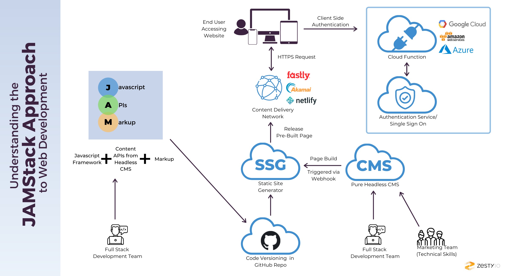
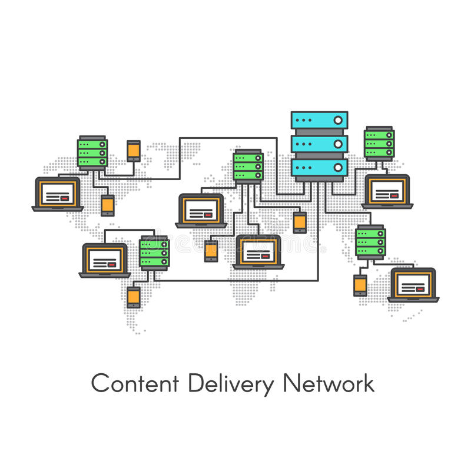
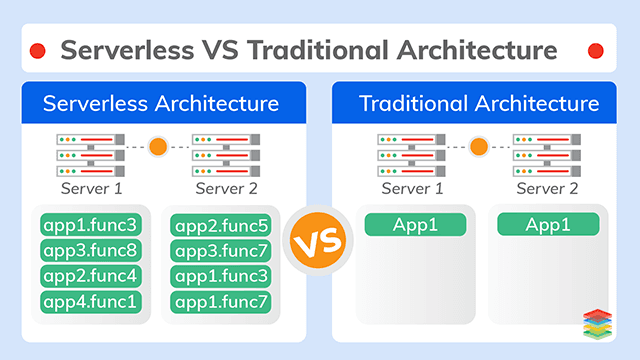
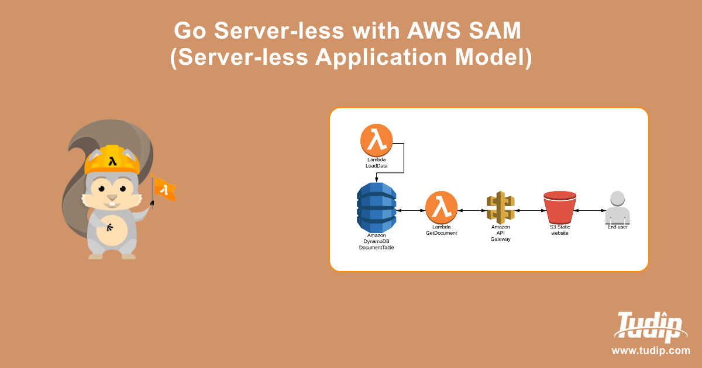
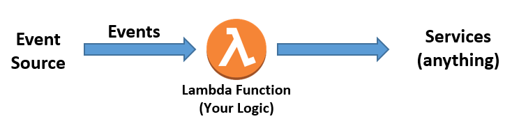
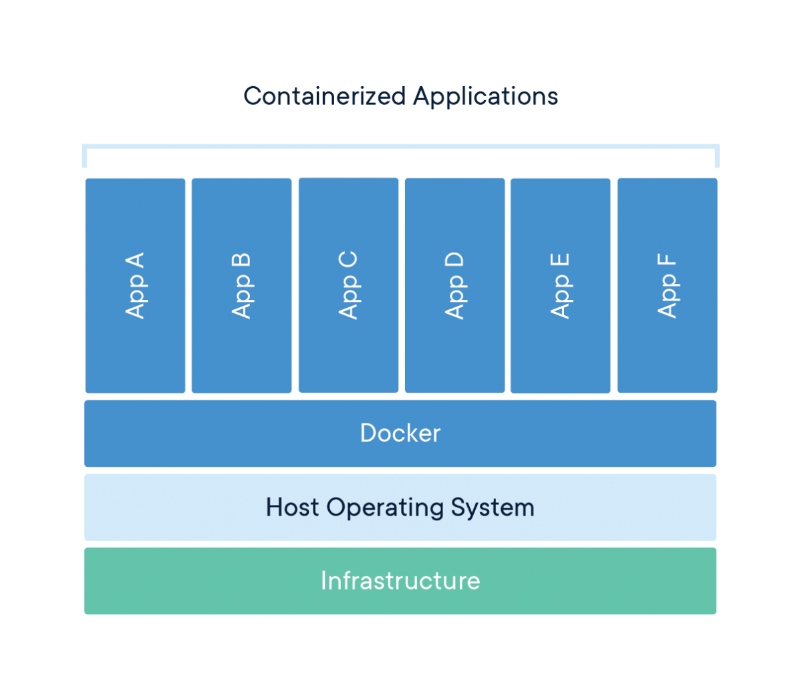

# Deployment And Integration

So far, we've built projects that run on our own computers. Today, we'll cover how code gets tested and deployed, including the tools used within ACM and how to set up Continuous Integration pipelines!

## Table of Contents

- [Frontend Deployment](#frontend-deployment)
  - [The Jam Stack](#the-jam-stack)
  - [CDNs](#cdns)
  - [Netlify](#netlify)
- [Back End Deployment](#back-end-deployment)
  - [Server Vs Serverless Architecture](#server-vs-serverless-architecture)
  - [Server Deployment](#server-deployment)
    - [Deploying With Containers](#deploying-with-containers)
  - [Cloud Functions](#cloud-functions)
- [Machine Independence](#machine-independence)
  - [Docker](#docker)
  - [Docker Compose](#docker-compose)
  - [Deployment From Github](#deployment-from-github)
- [Testing With Jest](#testing-with-jest)
  - [Unit Tests](#unit-tests)
  - [Testing an API With Supertest](#testing-an-api-with-supertest)
  - [Running Tests in ACM Projects](#running-tests-in-acm-projects)
- [Continuous Integration](#continuous-integration)
- [Monorepositories Vs Separate Repositories](#monorepositories-vs-separate-repositories)
  - [CORS Issues](#cors-issues)
- [Conclusion](#conclusion)
- [References](#references)

## Frontend Deployment

In week 1, we saw how easy it was to deploy static websites on Github Pages by simply adding GitHub pages to your repository! When deploying websites, there is a popular architecture being used nowadays to showcase your project to the world, and today we'll talk about the **Jam Stack**.

### The Jam Stack

The [Jam Stack](https://jamstack.wtf/) stands for

- **J** JavaScript For Interactivity
- **A** APIs for dynamic data retrieval/requests
- **M** Markup with Static HTML Files



(API stands for application programming interface, and is a way for different programs to communicate amongst each other!)

While that is what JAM Stack originally stood for, it's more broadly used now to define an architecture for building websites:

- Decoupling The Front and Backend, where the front-end simply makes API requests to a back-end deployed separately, and does as little processing as possible on the front-end.
- Thinking of performance first by pre-rendering HTML and CSS for faster [first contentful paint](https://developer.mozilla.org/en-US/docs/Glossary/First_contentful_paint) (which means that the user knows that the page is loading!)

### CDNs

More on the topic of performance and speed, CDNs or Content Delivery Networks, are how modern-day JAM Stack architecture ensures speed of deploying your website. CDNs essentially are a distributed system that plops down your website content in separate server locations throughout the world, ensuring that clients only have to communicate with the server that will give them the most optimal load time and taking the load off of a single centralized server.



### Netlify

[Netlify](https://www.netlify.com/) is one of the most popular tools used to deploy JAM Stack websites, and it makes deploying your front-ends easy with the simple click of a button!

By connecting your repository to Netlify, it's easier than ever to get a URL to your website, and deploy websites that abide by [JamStack](#the-jam-stack) rules! This is how the ACM website is deployed. [Vercel](https://vercel.com/), made by the creators of Next.js, is another popular option that works in much the same way.

However, some projects can't simply use APIs and need their own backends as well, and we can't use Netlify to deploy them!

## Back End Deployment

The JAM Stack excels for front-end architecture, but cannot be used if you want to deploy a project which utilizes a backend! Server-side code contains logic that can't be explicitly shown to the user, and thus can't be cached by a CDN, and thus requires compute time. There are actually two ways that you can deploy backends for your projects, the traditional way with a server, or server-less through cloud functions. We'll cover both and see the benefits/drawbacks of each!

### Server Vs Serverless Architecture

Prior to the mid 2010s, the main way that one deployed backends was with a dedicated back-end server!


However, starting recently, the usage of cloud functions and server-less architecture has grown more popular across cloud service providers with the growth of services like Amazon Lambda Functions, Google Cloud Functions, etc.

Let's see traditional server deployment first!

### Server Deployment

By deploying your backends to cloud provider services like AWS EC2, they handle having your backend ready for incoming requests, with a metric called [server uptime](https://www.kaseya.com/blog/2020/10/08/server-uptime-monitoring/#:~:text=Server%20uptime%20is%20the%20total,measured%20by%20server%20monitoring%20tools.).

Compared to serverless computing like shown below: traditional servers have a few advantages and disatvantages:

| PROS                                            | CONS                                 |
| ----------------------------------------------- | ------------------------------------ |
| Easier Debugging as you handle all server logic | Increased Cost                       |
| Increased Security                              | More Overhead Management/Maintanence |

As stated in the JAM Stack section, backend servers are normally decoupled from front-ends because they take time to warm-up and get online. Backend servers excel in good uptime and constant availability, but that comes at the cost of the upkeep necessary to keep a server running. A more modern approach that addresses the issue of the upkeep cost necessary to keep a server running is through using serverless architecture and cloud functions!

### Deploying With Containers

Most backends today are deployed as **containers**, which package your code along with everything it needs to run. You build the container once, and then run it on a server. This is how the membership portal runs: its frontend, backend, and databases are each containers, and you can see how they fit together in the `membership-portal-deployment` repository.

Services like [Render](https://render.com/), [Fly.io](https://fly.io/), and [AWS](https://aws.amazon.com/) can run a container for you. We'll look at how to build one in the [Docker](#docker) section below.

### Cloud Functions

If backend servers are used to decouple the front-end and back-end of your project, cloud functions and serverless architecture take it one step further and separate out different tasks of your backend into different **event handlers** and has the cloud provider handling the storage/resources necessary to handle each request.



Instead of a single server handling all of your requests, you distribute all of your backend's logic across different event handlers that fire off when you want to.



Serverless computing has gotten **very** popular in the last couple of years due to a couple of key factors:

- The cloud provider handles all the infrastructure needed for your servicem and distribution of tasks is done through a decentralized serverless model.
- Reduced upkeep cost due to only triggering certain functions when necessary
- Event driven models require less maintenance as the logic behind each request is encapsulated in each handler.

Overall, these models both have their pros and cons, but as serverless computing advances, it seems as though it might be the future of project development as we know it!

## Machine Independence

With cloud deployment, it's important to note that it is **not the version on your local machine** that is the version that is being deployed, it is the cloud provider of your choice doing so. To avoid issues like "it worked on my machine, why doesn't it work now :(( " there are a slew of tools that one can use to ensure that things are working as intended for **all users** of your project and to avoid environment related issues for everyone.

### Docker

Docker is a tool that is used to ensure that applications run smoothly from one computing environment to another.



With docker containers, one includes all the code, runtime specs, system tools, libraries, extra configuration necessary to run code, independent of machines.

Docker containers are similar to virtual machines in that it allows all programming environments to use them, however they use the host's kernel instead of having their own Operating System interface, and are lightweight as they don't need all the overhead necessary included by packaging in an Operating System!

Dockerfiles are used to configure your docker container, and contain a whole slew of commands:

- FROM: to tell Docker what image to use (set of instructions to set up Docker for your specific platform/use case)
- RUN: execute an instruction
- CMD: tell Docker what service to run

Let's take a look at a Dockerfile for an Express app and break down what exactly it does!

```Dockerfile
# Start from an image that already has Node installed
FROM node:22-alpine
# Install pnpm, since the image only comes with npm
RUN npm install -g pnpm
# Run the rest of these commands inside of the /app folder
WORKDIR /app
# Copy over the dependency list, and install what's on it
COPY package.json pnpm-lock.yaml pnpm-workspace.yaml* ./
RUN pnpm install --prod --frozen-lockfile
# Copy over the rest of our source code
COPY . .
# Document that the app listens on port 8080
EXPOSE 8080
# The command that starts the app
CMD ["node", "server.js"]
```

We copy the dependency files before our code on purpose. Docker saves each step, so if only your code changes, it can skip reinstalling all of your dependencies.

You should also add a `.dockerignore` file so that your local files don't get copied in:

```
node_modules
.env
```

To build the image and run it as a container, use:

```sh
$ docker build -t blog-api .
$ docker run -p 8080:8080 --env-file .env blog-api
```

`-p 8080:8080` connects a port on your computer to a port in the container, written as `COMPUTER:CONTAINER`. Without it, you couldn't reach the app.

If your app uses a database, it won't be able to connect yet, since `localhost` inside of a container means the container itself. Docker Compose solves this.

### Docker Compose

Real projects have more than one container. **Docker Compose** starts them all together, based on a `docker-compose.yml` file. You already used it to start your database, and here it is with the API added:

```yml
services:
  api:
    build: .
    ports:
      - "8080:8080"
    environment:
      DATABASE_URL: postgres://dev:dev@db:5432/blog
    depends_on:
      db:
        condition: service_healthy
  db:
    image: postgres:16
    environment:
      POSTGRES_USER: dev
      POSTGRES_PASSWORD: dev
      POSTGRES_DB: blog
    ports:
      - "5433:5432"
    volumes:
      - dbdata:/var/lib/postgresql/data
    healthcheck:
      test: ["CMD-SHELL", "pg_isready -U dev -d blog"]
      interval: 2s
      timeout: 5s
      retries: 10

volumes:
  dbdata:
```

Notice that the API reaches the database at `db:5432`, not `localhost`. Containers in the same Compose file can reach each other using their service names. The `healthcheck` and `condition` make the API wait until the database is ready, since Postgres takes a few seconds to start.

These are the commands you'll use most:

```sh
$ docker compose up --build   # build and start everything
$ docker compose up -d        # start everything in the background
$ docker compose logs -f api  # follow the logs of one service
$ docker compose down         # stop everything
```

This is how you run the membership portal on your computer. The ports it uses are `8000` for the frontend and `8080` for the backend. Follow the setup steps in the `membership-portal-deployment` README, and ask a lead for the password that you need to generate the environment file. Since the dependencies are installed inside of the containers, **don't run `npm install` or `pnpm install` locally** in the portal repositories.

### Deployment From Github

By using version control like GitHub, one can ensure that across their team, everyone is up to date on the deployed codebase and that continuous integration/deployment happens!

## Testing With Jest

How do you know your change didn't break something else? You could click around the whole site each time, or you could write **automated tests** that check for you. Both the ACM website and the membership portal use [Jest](https://jestjs.io/).

```sh
$ pnpm add -D jest supertest
```

This ends with an `ERR_PNPM_IGNORED_BUILDS` error about `@parcel/watcher`. Your packages are still installed, and Jest works without that script, but a fresh install will keep failing until you make a decision about it. To turn the script down, create a file named `pnpm-workspace.yaml` with these lines, and commit it:

```yml
allowBuilds:
  "@parcel/watcher": false
```

Add a script to your `package.json`:

```json
"scripts": {
  "test": "jest"
}
```

### Unit Tests

A **unit test** checks one small piece of code by itself. Jest finds files ending in `.test.js`, and runs them. Say we have a function that makes a URL-friendly version of a title:

```js
// slug.js
const toSlug = (title) => title
  .toLowerCase()
  .trim()
  .replace(/[^a-z0-9]+/g, "-")
  .replace(/^-|-$/g, "");

module.exports = { toSlug };
```

```js
// slug.test.js
const { toSlug } = require("./slug");

describe("toSlug", () => {
  test("lowercases and replaces spaces", () => {
    expect(toSlug("Best Boba in Westwood")).toBe("best-boba-in-westwood");
  });

  test.each([
    ["  Spaces  ", "spaces"],
    ["Rock & Roll!", "rock-roll"],
  ])("turns %p into %p", (title, slug) => {
    expect(toSlug(title)).toBe(slug);
  });
});
```

- `describe` groups related tests together.
- `test` is a single test, and its name should say what it checks.
- `expect(...)` checks a value, using a **matcher** like `.toBe()`, `.toEqual()`, or `.toHaveLength()`.
- `test.each` runs the same test with different inputs.

Each test follows the same pattern: set things up, run the code, and check the result. Try to test the unusual cases too, like empty values and invalid input, since that's where bugs live.

### Testing an API With Supertest

[Supertest](https://github.com/forwardemail/supertest) sends real requests to your Express app, without needing a running server. For this to work, your app needs to be exported separately from the code that starts it:

```js
// app.js
const express = require("express");

const app = express();
app.use(express.json());

app.get("/health", (req, res) => res.json({ status: "ok" }));

app.post("/posts", (req, res) => {
  if (!req.body.title) return res.status(400).json({ error: "A title is required" });
  return res.status(201).json({ title: req.body.title });
});

module.exports = app;
```

```js
// server.js
const app = require("./app");

app.listen(8080, () => console.log("Listening on port 8080"));
```

```js
// app.test.js
const request = require("supertest");
const app = require("./app");

describe("posts API", () => {
  test("creates a post", async () => {
    const res = await request(app).post("/posts").send({ title: "Hello" });

    expect(res.status).toBe(201);
    expect(res.body.title).toBe("Hello");
  });

  test("rejects a post without a title", async () => {
    const res = await request(app).post("/posts").send({});

    expect(res.status).toBe(400);
  });
});
```

The membership portal's backend tests work the same way. For examples, see `tests/unit` and `tests/integration` in the `membership-portal` repository.

### Running Tests in ACM Projects

| Project                  | Command (these projects use npm)                         |
| ------------------------ | -------------------------------------------------------- |
| ACM website              | `npm test`                                               |
| Membership portal UI     | `npm test`                                               |
| Membership portal backend | `npm run test:unit` and `npm run test:integration`      |

Before opening a Pull Request, run the tests and the linter (`npm run lint`). When you fix a bug, it's a good habit to add a test that would have caught it.

## Continuous Integration

Continuous Integration is a software development practice that automatically tests and builds your code whenever you push changes ready for releases, and helps to prevent bugs from happening in production!

A lot of the deployment tools we've discussed like Netlify actually come with continuous deployment included, using the latest pushed changes as the basis for what gets deployed!

On top of this, Github has a tool called [Github Actions](https://docs.github.com/en/actions) which are a way to add Continuous Integration tests to your code and ensure that things run smoothly, or can also be used in a more broad sense to accomplish a task everytime that an action is performed on GitHub. Let's take a look at a yml script, saved at `.github/workflows/ci.yml`, that lints and tests our code!

```yml
name: CI
on:
  push:
    branches: [main]
  pull_request:

jobs:
  test:
    runs-on: ubuntu-latest

    steps:
      - name: Checkout Git repo
        uses: actions/checkout@v4

      - name: Set up pnpm
        uses: pnpm/action-setup@v6

      - name: Set up Node
        uses: actions/setup-node@v4
        with:
          node-version: 22
          cache: pnpm

      - name: Install dependencies
        run: pnpm install --frozen-lockfile

      - name: Run linter
        run: pnpm run lint

      - name: Run tests
        run: pnpm test
```

What this github action does, is that on every Pull Request and every push to `main`, it installs the dependencies we need and runs our linter and tests, failing if there are any errors! `--frozen-lockfile` installs exactly what's in `pnpm-lock.yaml`, and fails if it doesn't match `package.json`. The pnpm step uses the version listed under `packageManager` in your `package.json`, which `pnpm init` adds for you. The ACM repositories use npm, so their workflows use `npm ci`, which does the same thing. This tool can be pretty powerful, as some errors can slip through the cracks and CI/CD can help prevent errors such as these from happening.

The ACM website and the membership portal both run checks like these on Pull Requests, and you can read their workflows in each repository's `.github/workflows` folder.

## Monorepositories Vs Separate Repositories

When making repositories for projects, it can be a hard decision to decide whether you want to deploy everything to a single repository or if you want to separate out your front and backend.

A **monorepository** structure is exactly what it sounds like! All code relating to the project is within a single repository, and people like using this approach as it centralizes all the information about a project to a single place.

On the other hand, separating out the front and back-end of a project is also a well-liked approach as it becomes easier to track issues relating to different discrete parts of the project, and monorepos can get too unwieldy and large.

While it is true that a lot of deployment services assume that a repository serves only front-end or back-end, you can set up custom configuration to let it support a monorepo structure, such as Netlify's [monorepo settings](https://docs.netlify.com/build/configure-builds/monorepos/). The membership portal uses separate repositories for its frontend, backend, and deployment. No matter what method you choose, deployment support for both are available and it's truly just up to personal preference!

### CORS Issues

However, one caveat with choosing to deploy your front and back-end separately (this issue is still seen in mono-repo structure if the front and back-end are decoupled!) is that your backend server might cause some [CORS](https://developer.mozilla.org/en-US/docs/Web/HTTP/CORS) issues, or cross origin resource sharing, which can limit what front-end hosts can get information or load resources from your backend. Various backend frameworks each have their own methods of dealing with these errors, allowing developers the option of greenlighting specific front-end URLs or providing specific access instructions, and you just have to see how your specific framework handles CORS issues!

For example, Express has [CORS middleware](https://expressjs.com/en/resources/middleware/cors.html) that is used to enable CORS on your express app, and many other frameworks handle it separately!

## Conclusion

Overall, we've covered from a high level different deployment strategies that people use nowadays, and how tests, Docker, and CI help us ship our projects with confidence!

## References

- [Jam Stack](https://jamstack.wtf/)
- [Docker from Dev Training Last Year](https://docs.google.com/presentation/d/1D3tU_vWsBqd_EEHVAp8-N_l1itm44WfvS_1NvK7H9Fo/edit#slide=id.g64a16e7b54_0_148)
- [Server Vs. Serverless](https://www.cloudflare.com/learning/serverless/why-use-serverless/)
- [Github Actions](https://docs.github.com/en/actions)
- [Jest Getting Started](https://jestjs.io/docs/getting-started)
- [Docker Get Started](https://docs.docker.com/get-started/)
